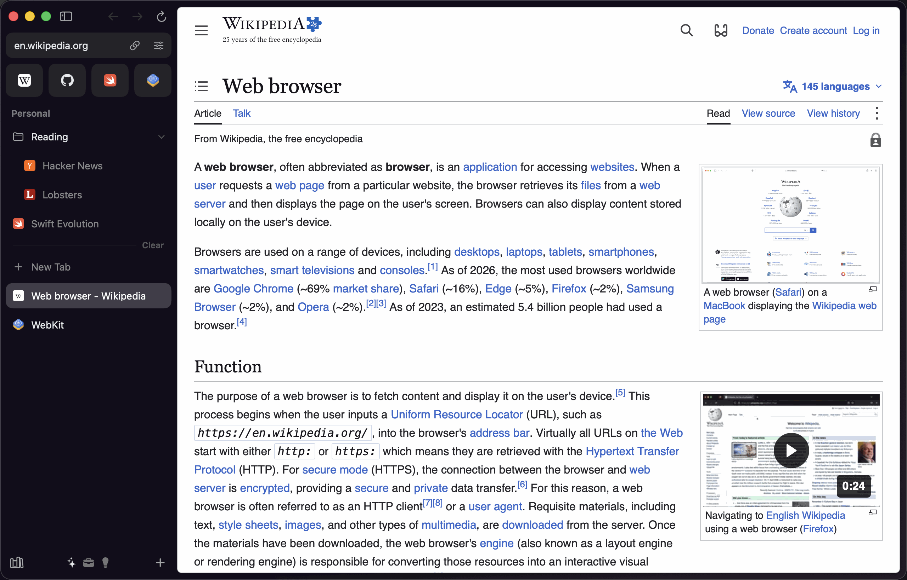
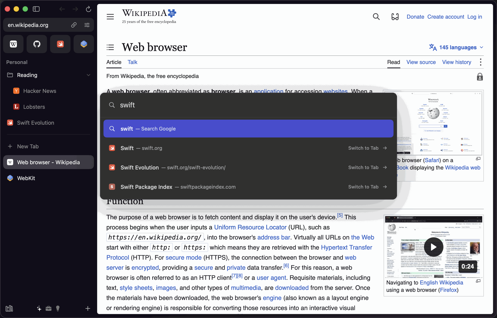
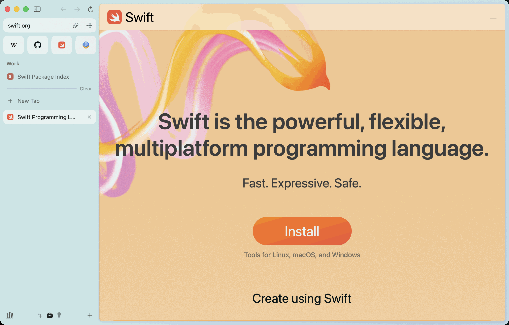

<div align="center">


# Marc

**A native, open-source macOS browser with an Arc-style sidebar, Spaces and Command Bar.**

Built with Swift, SwiftUI, AppKit and WebKit.

[](https://github.com/devleloper/Marc/actions/workflows/ci.yml)
[](LICENSE)


</div>



<table>
  <tr>
    <td width="50%"></td>
    <td width="50%"></td>
  </tr>
  <tr>
    <td align="center">The Command Bar (<kbd>⌘T</kbd>)</td>
    <td align="center">Each Space has its own theme</td>
  </tr>
</table>

<sub>Screenshots show pages from en.wikipedia.org (text available under CC BY-SA 4.0) and swift.org.
Site names and logos belong to their owners. Regenerate them with <code>make screenshots</code>.</sub>

Marc brings the browsing model popularized by Arc to a fully native Mac app: your tabs live in a
sidebar, organized into Spaces that each have their own theme and profile, and almost
everything is reachable from the keyboard through the Command Bar. It uses the system WebKit, so
it's fast, light on memory and battery, and gets Safari's security updates.

> [!NOTE]
> Marc is an independent project. It is not affiliated with The Browser Company and contains
> no code or assets from Arc.

## Features

| | |
| --- | --- |
| **Sidebar** | Address field, favorites grid, pinned tabs with nested folders, and today tabs that archive themselves after a period you choose. Drag and drop everywhere. Hide it with ⌘S. |
| **Spaces** | Separate sets of tabs with their own gradient themes and icons. Swipe between them or press ⌃1–⌃9. |
| **Profiles** | Each Space belongs to a profile with isolated cookies, storage, history and passwords. Incognito windows keep nothing. |
| **Command Bar** | ⌘T or ⌘L to search, open URLs, switch tabs, search history, run commands and search sites with Tab. |
| **Split View** | Up to four pages side by side (⌃⇧=), resizable, saved in the sidebar like a tab. |
| **Peek** | Links to other sites from pinned tabs and favorites open in a floating preview. |
| **Little window** | Links opened from other apps can open in a small window you can promote to a tab. |
| **Boosts** | Restyle any site with colors and fonts, add CSS or JavaScript, and zap elements away. |
| **Notes and Library** | Quick notes in the sidebar; downloads, archived tabs, Boosts and notes in one place. |
| **Media** | A mini player for tabs playing audio or video, with mute and Picture in Picture. |
| **Privacy** | Built-in content blocking with EasyList, EasyPrivacy and Fanboy's Annoyance List. No telemetry. |
| **Passwords** | A Keychain-backed password manager with autofill, a generator and optional Touch ID. |
| **Extensions** | Safari-compatible web extensions through WebKit's extension API (folders, `.zip`, `.crx`). |
| **Import** | Bring over Arc's Spaces and pinned tabs, and bookmarks and history from Chrome and Safari. |
| **AI** | Summarize a page, ask questions about it and tidy tab titles, with Claude or on-device Apple Intelligence models. |

See the [feature inventory](docs/FEATURE_INVENTORY.md) for the complete list with keyboard shortcuts, and
[platform limitations](docs/LIMITATIONS.md) for the few Arc features WebKit can't support.

## Requirements

- macOS 15.4 or later (AI features with on-device models need macOS 26 and Apple Intelligence).
- To build: Xcode 26 and [Homebrew](https://brew.sh).

## Installation

Download the latest preview build from the [Releases page](https://github.com/devleloper/Marc/releases).
Previews aren't notarized yet: after moving Marc to Applications and trying to open it, choose
**Open Anyway** in System Settings → Privacy & Security. They don't update themselves, so check
the Releases page for new versions. Notarized builds with automatic updates will follow.

Or build Marc from source:

```bash
git clone https://github.com/devleloper/Marc.git
cd Marc
make bootstrap
make run
```

`make bootstrap` installs XcodeGen, SwiftLint, SwiftFormat and xcbeautify with Homebrew and
generates `Marc.xcodeproj`. Development builds are ad-hoc signed and need no Apple Developer
account.

## Development

| Command | What it does |
| --- | --- |
| `make build` / `make run` | Build the Debug app / build and open it. |
| `make test` | Run the package tests and the UI tests. |
| `make lint` / `make format` | Check / fix formatting and style. |

The code is split into a thin app target and a local Swift package, `MarcKit`:

```
Marc (app) ── composition root, menus, windows, updates
 └─ MarcUI ─────────── features: sidebar, Command Bar, split, settings…
     ├─ MarcDesignSystem   tokens, theme palette, motion, components
     ├─ MarcWebKit         tabs, scripts, content blocking, downloads, extensions
     ├─ MarcPersistence    GRDB databases and repositories
     ├─ MarcPlatform       Keychain, authentication, networking, AI providers
     └─ MarcCore           domain model, workspace store, pure rules
```

Read [ARCHITECTURE.md](docs/ARCHITECTURE.md) for the design and [CONTRIBUTING.md](CONTRIBUTING.md)
before opening a pull request.

## Privacy and security

Marc doesn't collect analytics. It connects only to the sites you open, the search-suggestion
service of your search engine, filter-list publishers when content blocking is on, the Claude
API when you add a key, and GitHub to check for updates. Passwords and API keys are stored in
the Keychain. The app runs in the App Sandbox with the hardened runtime.

Please report vulnerabilities privately as described in [SECURITY.md](SECURITY.md).

## Contributing

Contributions are welcome: bug reports, fixes, features from the [roadmap](docs/ROADMAP.md) and
documentation. Start with [CONTRIBUTING.md](CONTRIBUTING.md) and the
[Code of Conduct](CODE_OF_CONDUCT.md).

## License

Marc is available under the [Apache License 2.0](LICENSE). See [NOTICE](NOTICE) for
third-party attributions.
